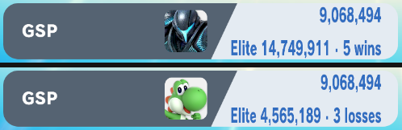

# gsp-visualizer

> **Disclaimer:** this project was developed with the assistance of AI
> (Claude, Codex and other coding agents) under the operator's direction and
> review. Nothing is claimed beyond the dated tests cited below.

A Skyline plugin for Super Smash Bros. Ultimate 13.0.5 that shows, under the
hovered fighter's GSP on the Quickplay character select, the GSP Elite Smash
takes and an estimate of the matches to get there. For a fighter already in
Elite Smash it shows the losses in a row that would take it out:



(Eden, 2026-10-30: an unplayed fighter at 1500 with 2-minute rules; below,
the same fighter with the threshold lowered to 1400 by the diagnostic
build.)

Everything comes from the game itself: the threshold is the server's
setting 1201, its GSP is the game's own converter, and the estimate runs the
game's own rating update (Glicko-2 × ruleset K) on the fighter's cached
record with the server's settings. UI only: no rating, network or match
state changes.

**Status (2026-10-30):** host tests pass; checked in Eden (one console, LAN
Online with the rating runtime):

- the release and diagnostic builds install on 13.0.5 (all guards match,
  no heap allocation) and label every hovered fighter;
- the inputs logged per hover match the game: fighter slot, record
  1500/130/1500, shown GSP 9,068,494, threshold 1642, σ 0.06;
- the threshold's GSP from the game's converter is 14,749,911;
- the rules follow Preferred Rules: Time 2:00 gave K 0.9 and 5 wins, Time
  3:00 gave K 1.0 and 4 wins.

Not checked: Nintendo's live server (Eden replays a captured settings
reply), languages other than English, a real Switch.

## Research

- [docs/GSP-FORMULA.md](docs/GSP-FORMULA.md): how 13.0.5 updates the rating
  after a win or loss and turns it into the GSP on screen, with every Eden
  number reproduced.
- [docs/ELITE-ESTIMATE.md](docs/ELITE-ESTIMATE.md): where the Elite Smash
  threshold comes from, how the estimates are defined, example counts.
- [docs/CSS-LABEL.md](docs/CSS-LABEL.md): the character select code path
  and the plugin's hooks.

## Install

Copy `libgsp_visualizer.nro` to
`sd:/atmosphere/contents/01006A800016E000/romfs/skyline/plugins/`. It
checks the game version and every hook site first; on any other version it
installs nothing. The install line goes to
`sd:/ultimate/gsp-visualizer/events.log`.

## Build

```text
cargo test
cargo skyline build --release
cargo skyline build --release --features diag   # Eden-only diagnostics
```

The diagnostic build logs each label's inputs to `events.log` and reads
`sd:/ultimate/gsp-visualizer/diag.txt` (`joiner=newline|space`,
`dot=middle|dash`, `threshold=<rating>|native`).

## Tools

```text
python3 tools/gsp_update.py 1500 130 1500 130 win      # new A B C
python3 tools/gsp_display.py 16141400 1500 1536        # displayed GSP
python3 tools/gen_vectors.py                           # Rust test vectors
python3 tools/guard.py <main> 1a1c0ec                  # hook-site guard bytes
```

`peek.py`, `scan_imm.py`, `bl_callers.py`, `settings.py` and `find_u32.py`
are the small readers used on the flat `main` image, the captured settings
reply and the save.
