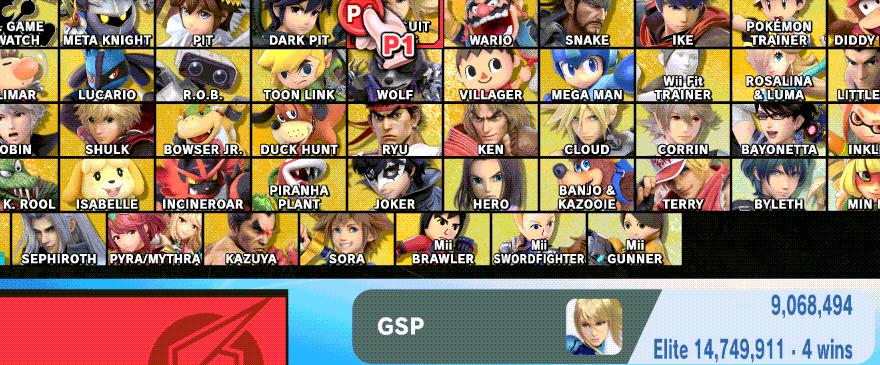
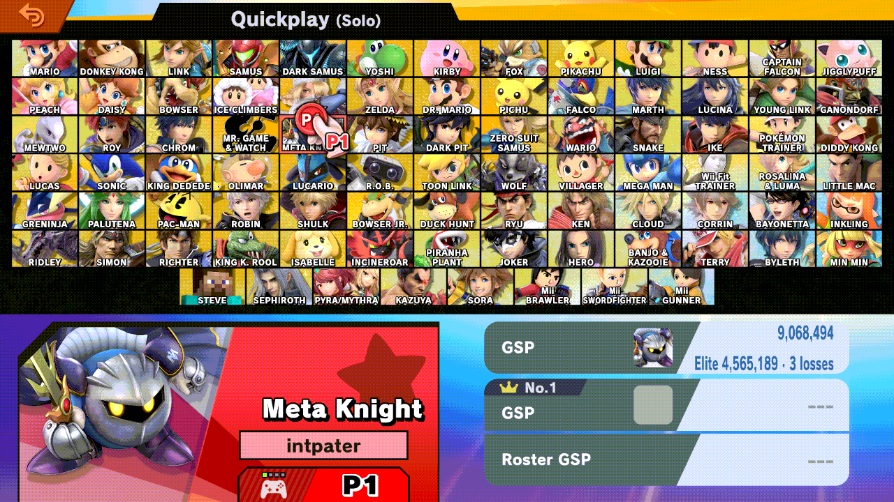

# gsp-visualizer

> **Disclaimer:** this project was developed with the assistance of AI
> (Claude, Codex and other coding agents) under the operator's direction and
> review. Nothing is claimed beyond the dated tests cited below.

A Skyline plugin for Super Smash Bros. Ultimate 13.0.5. On the Quickplay
character select it adds a line under the hovered fighter's GSP: the GSP
Elite Smash takes, and how many wins in a row get you there.



*Eden, 2026-10-30: unplayed fighters (rating 1500), Preferred Rules Time
3:00, the server's threshold 1642 (GSP 14,749,911).*

A fighter already in Elite Smash shows the losses in a row that would take
it out instead:



*Same fighters with the threshold lowered to 1400 by the diagnostic build,
since no fighter on the test profile is in Elite Smash.*

- **Threshold:** read live on every hover from the server's Elite Smash
  setting (1201) and shown as GSP by the game's own converter, so it follows
  the server as the threshold and the player count rise. Nothing is
  hard-coded; Eden replays one captured server reply, hence the fixed 1642
  in the GIFs.
- **Estimate:** the game's own rating update (Glicko-2 × the ruleset's K),
  run on the fighter's record against opponents at your rating. K follows
  your Preferred Rules (2:00 time: 0.9, 3:00: 1.0).
- UI only: no rating, network or match state changes.

## Install

Copy `libgsp_visualizer.nro` to
`sd:/atmosphere/contents/01006A800016E000/romfs/skyline/plugins/`. On any
version other than 13.0.5 it installs nothing.

## Build

```text
cargo test
cargo skyline build --release
```

## Tested

Eden, 2026-10-30, one console on LAN Online with a rating runtime, English:
both builds install and label every hovered fighter, and the logged inputs
match the game. Not tested: Nintendo's live server, other languages, a real
Switch. Details: [docs/CSS-LABEL.md](docs/CSS-LABEL.md).

## Research

- [docs/gsp-formula/](docs/gsp-formula/): how 13.0.5 updates GSP after a
  win or loss, with every Eden number reproduced, and the models and image
  readers used.
- [docs/ELITE-ESTIMATE.md](docs/ELITE-ESTIMATE.md): the threshold's source
  and the estimate, with example counts.
- [docs/CSS-LABEL.md](docs/CSS-LABEL.md): the character select hook and the
  Eden check.
