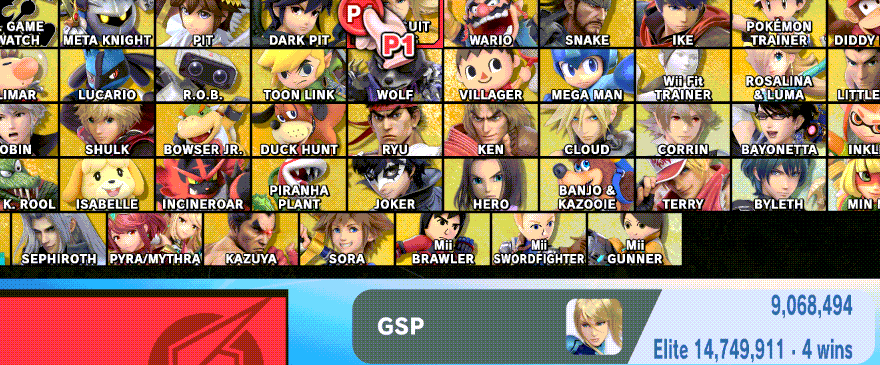
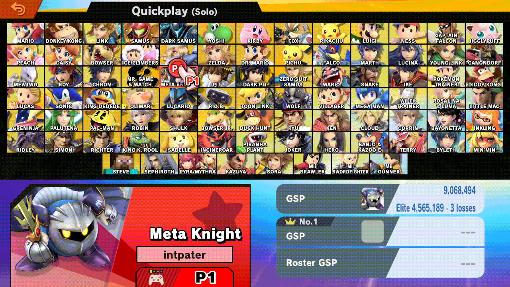

# gsp-visualizer

> **Disclaimer:** this project was developed with the assistance of AI
> (Claude, Codex and other coding agents) under the operator's direction and
> review. Nothing is claimed beyond the dated tests cited below.

A Skyline plugin for Super Smash Bros. Ultimate 13.0.5. On the Quickplay
character select it adds a line under the hovered fighter's GSP: the GSP
Elite Smash takes, and how many wins in a row get you there.



*Eden, 2026-10-30, run e04, 0.1.0 release build (`80af4f63…`): unplayed
fighters (rating 1500), Preferred Rules Time 3:00, the server's threshold 1642
(GSP 14,749,911).*

A fighter already in Elite Smash shows the losses in a row that would take
it out instead:



*Eden, 2026-10-30, run e08, 0.1.0 release build (`80af4f63…`): Sephiroth at
rating 1700 (a real Quickplay match created its record, then Eden's rating
server was seeded). The game itself switches to Elite Smash: gold header, only
Sephiroth lit. Pyra/Mythra, not in Elite, shows wins.*

- **Threshold:** read from the server's Elite Smash setting on every hover
  and turned into GSP by the game's own converter, so it follows the server
  as the threshold and the player count change. Nothing is hard-coded. Eden
  replays one recorded server reply, hence the fixed 1642 in the GIFs.
- **Estimate:** the game's own rating update, run on the fighter's record
  against opponents at your rating. It follows your Preferred Rules time
  limit: with the recorded server settings a 2:00 match moves the rating 0.9
  times as far as a 3:00 one.
- **Only the text changes:** no rating, network or match state.
- **Works next to other plugins:** if another plugin hooks the same place,
  both keep working, and other plugins can show the label themselves
  ([details](docs/CSS-LABEL.md#what-the-plugin-does)).
- **Small:** 124 KiB of game memory once loaded (code and data), no heap
  use.

## Install

Copy `libgsp_visualizer.nro` to
`sd:/atmosphere/contents/01006A800016E000/romfs/skyline/plugins/`. On any
version other than 13.0.5 it installs nothing.

## Build

```text
cargo test
cargo skyline build --release
```

## Tested

Eden, 2026-10-30 and 2026-10-31 (UTC), one console on LAN Online with a
rating runtime, English: 0.1.0, 0.2.0 and 0.3.0 installed and labelled every
hovered fighter, and the values the diagnostic builds logged matched the
game's. 0.3.0 also ran with stand-ins for a plugin that hooks the same place
without sharing: the label still showed and the stand-ins still ran.
Details: [docs/CSS-LABEL.md](docs/CSS-LABEL.md).

Switch, 2026-11-02, 13.0.5 on Nintendo's servers (Quickplay), next to 15
other plugins: 0.3.0 (`879ef69b…`, built from `a0dac0f`) logged
`role=owner apply=stock/near guests=0 label=on result=installed
heap_allocations=0` on each of four boots, and the operator reported the
label working in that play session. Not tested: other languages.

## Research

- [docs/gsp-formula/](docs/gsp-formula/): how 13.0.5 updates GSP after a
  win or loss, with every Eden number reproduced, and the models and image
  readers used.
- [docs/ELITE-ESTIMATE.md](docs/ELITE-ESTIMATE.md): the threshold's source
  and the estimate, with example counts.
- [docs/CSS-LABEL.md](docs/CSS-LABEL.md): the character select hook and the
  Eden check.

## License

MIT
